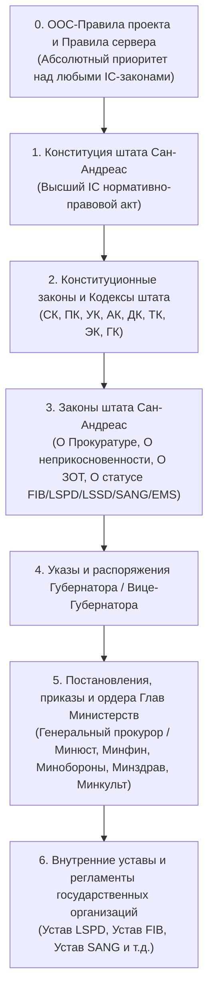

# Иерархия нормативно-правовых актов (НПА) и кодексы GTA 5 RP (`legal-hierarchy-and-codes.md`)

Законодательная база каждого сервера GTA 5 RP располагается в подразделе **«Правительство» → «Законодательная база»** (или «Законы штата Сан-Андреас»). Для правильного правового анализа исков, постановлений прокуратуры, задержаний и увольнений ИИ-агент должен строго применять иерархию законов и понимать предмет регулирования каждого кодекса.

---

## 1. Пирамида юридической силы НПА (Сверху вниз)

При любом противоречии (коллизии) между двумя документами **всегда применяется документ, стоящий выше в этой иерархии**:

> [!IMPORTANT]
> **Частая ловушка в исках и жалобах**: руководство фракции увольняет или наказывает сотрудника со ссылкой на пункт Внутреннего Устава фракции (Уровень 6), который противоречит Трудовому кодексу или Процессуальному кодексу (Уровень 2). В суде такое наказание признается незаконным в силу верховенства Кодекса над Уставом.

---

## 2. Справочник основных Кодексов и Законов штата Сан-Андреас

Ниже перечислены базовые кодексы и законы, на которые ссылаются в 95% документов на форуме:

| Сокращение | Полное название | Что регулирует и что в нем искать |
| :--- | :--- | :--- |
| **Конституция СА** | Конституция штата Сан-Андреас | Права и свободы граждан, разделение властей (Законодательная — Конгресс/Сенат, Исполнительная — Губернатор и Кабинет Министров, Судебная — Верховный и Федеральный/Окружной суды), иерархия НПА, порядок импичмента и неприкосновенности. |
| **УК СА** (`УК`) | Уголовный кодекс штата Сан-Андреас | Преступления и уголовная ответственность (лишение свободы в Федеральной тюрьме Болингброук, судимость, уголовный штраф). • **Главы 6–10**: преступления против жизни, здоровья, свободы и собственности. • **Глава 12**: незаконный оборот оружия и спецсредств (`12.7`, `12.8`). • **Глава 15**: должностные преступления — **самые частые статьи в судах**: `15.1` (Превышение должностных полномочий), `15.1.1` (Злоупотребление полномочиями), `15.4` (Получение взятки), `15.6` (Халатность). • **Глава 16**: преступления против правосудия (`16.5` — Заведомо незаконное задержание, `16.12` — Злостное неисполнение судебного акта/постановления прокурора). • **Глава 17**: посягательство на жизнь/оскорбление сотрудника (`17.1`, `17.3`, `17.6` — Неповиновение законному требованию). |
| **ПК СА** (`ПК`) | Процессуальный кодекс штата Сан-Андреас | **Главный регламент для силовых структур (LSPD, LSSD, FIB, SANG, USSS)**: • Основания и точный порядок задержания (последовательность действий сотрудника, предъявление жетона/удостоверения, правило Миранды); • Стадии применения силы; • Порядок первичного и вторичного обыска; • Право на телефонный звонок и вызов адвоката (время ожидания ответа адвоката в рацию департамента — обычно `5–10 минут`, время на приезд — `10–15 минут`); • Вызов прокурора и начальства при задержании государственного служащего; • **Недопустимые доказательства** (улики, добытые с нарушением ПК, либо видеозапись без отыгровки боди-камеры / с повреждениями). • **Обязанность хранения видеофиксации задержания сотрудником** (обычно **72 часа** с момента процессуальных действий). |
| **СК СА** (`СК`) | Судебный кодекс штата Сан-Андреас | Подсудность дел, правила подачи исков, основания для отказа в принятии иска и оставления без движения, виды судопроизводства (уголовное, административное, гражданское), сроки рассмотрения, права сторон, ходатайства, порядок проведения очных заседаний и вынесения заочных решений. |
| **АК СА** (`АК`) | Административный кодекс | Административные правонарушения (хулиганство, ношение масок в общественных местах, нарушение общественного порядка) и размеры штрафов. |
| **ДК СА** (`ДК`) | Дорожный кодекс | Правила дорожного движения, парковки, основания для эвакуации ТС и штрафы за трафик-стоп. |
| **ТК СА** (`ТК`) | Трудовой кодекс | Порядок приема на работу, дисциплинарные взыскания (устный/строгий выговор, переаттестация, понижение, увольнение), законные основания для расторжения трудового договора работодателем, права работника на обжалование увольнения и восстановление в должности. |
| **ЭК СА** (`ЭК`) | Этический кодекс | Дресс-код государственных служащих (запрет на цветные волосы, неестественные линзы, татуировки на лице/шее/кистях, нестрогую одежду на службе) и нормы делового общения с гражданами (обращение на «Вы», запрет на грубость и провокации). |
| **Закон о ЗОТ** | Закон «О закрытых и охраняемых территориях» | Определяет границы общественных мест, охраняемых территорий (желтая зона — нахождение по цели визита) и закрытых территорий (красная зона — проход строго по пропуску/сопровождению) для мэрии, LSPD, LSSD, FIB, SANG и EMS. Нарушение границ ЗОТ квалифицируется по ст. `12.7 УК СА`. |
| **Закон о неприкосновенности** | Закон «О статусе неприкосновенности должностных лиц» | Перечень лиц, обладающих высокой и малой неприкосновенностью (Губернатор, Министры, Судьи, Прокуроры, Руководители гос. структур), запрет на их обыск/задержание (кроме задержания на месте тяжкого насильственного преступления) и порядок снятия неприкосновенности ордером (`IA` / `RI`). |

---

## 3. Как правильно читать структуру закона на форуме

Законы на форуме GTA 5 RP обычно оформлены одним из двух способов:
1. **Способ А (Внутри поста форума через спойлеры)**:
   * Пост `#1` содержит преамбулу и список спойлеров: `Спойлер: Глава I. Общие положения`, `Спойлер: Глава II. Процесс задержания` и т.д.
   * Используй скрипт `extract_thread_content.py` (из модуля `gta5rp-forum-navigation`) — он автоматически раскроет все главы за один запрос.
2. **Способ Б (Таблицы и посты по главам)**:
   * Каждая глава опубликована отдельным постом (`#1`, `#2`, `#3`...) внутри одной темы.
3. **Записи о поправках (Changelog)**:
   * В самом низу темы закона (или в последнем посте) обычно публикуются ссылки на журналы Конгресса/Сената о внесении поправок: *«Утверждено Конгрессом 10.08.2026, подписано Губернатором...»*.
   * Всегда проверяй дату события в иске против даты внесения поправки в статью закона (закон, ухудшающий положение лица, обратной силы не имеет).

---

## 4. Обозначение статей и ссылок на нормы права

При анализе текста документа распознавай следующие стандартные форматы записи правовых норм:
* `ст. 15.1 УК СА` / `статья 15.1 Уголовного кодекса` — Глава 15, Статья 1.
* `ч. 2 ст. 15.6 УК` / `ст. 15.6.1 УК` — конкретная часть или подпункт статьи.
* `п. "а" ч. 1 ст. 8 ПК СА` — пункт, часть и статья Процессуального кодекса.

> [!TIP]
> На разных серверах GTA 5 RP (Downtown, Strawberry, Vinewood, Milton и т.д.) нумерация отдельных статей или сроки в кодексах могут незначительно отличаться по решению местного Конгресса и Главного Следящего за Гос. структурами (Curator State). Если задача требует 100% точности по конкретной статье на конкретном сервере — открой раздел «Законодательная база» именно этого сервера и сверь дословную формулировку статьи.
