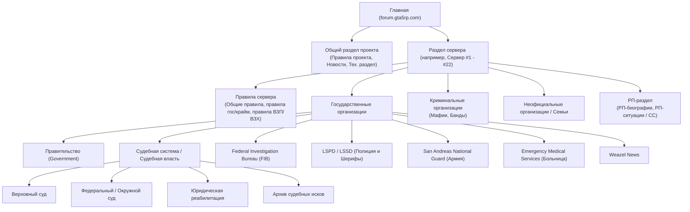

# Справочник URL-паттернов, DOM-селекторов XenForo 2.x и навигации (`forum.gta5rp.com`)

Форум `https://forum.gta5rp.com` построен на движке **XenForo 2.2+**. Все URL-адреса имеют ЧПУ-транслитерацию (slug) и числовой идентификатор сущности через точку (`.ID/`).

---

## 1. Анатомия URL-адресов

> [!TIP]
> Числовой ID после точки — единственная обязательная часть маршрута. Например, `https://forum.gta5rp.com/forums/verkhovnyi-sud.2188/` и `https://forum.gta5rp.com/forums/2188/` ведут на одну и ту же страницу (XenForo автоматически сделает 301-редирект на канонический URL со слагом).

| Сущность | Шаблон URL | Пример | Назначение |
| :--- | :--- | :--- | :--- |
| **Главная страница** | `/` | `https://forum.gta5rp.com/` | Список всех глобальных категорий и игровых серверов |
| **Категория / Сервер** | `/#<slug>.<id>` или `/categories/<slug>.<id>/` | `https://forum.gta5rp.com/#downtown.15` | Якорь на блок конкретного сервера на главной странице |
| **Раздел / Подфорум** | `/forums/<slug>.<id>/` | `https://forum.gta5rp.com/forums/verkhovnyi-sud.2188/` | Страница раздела со списком подфорумов, закрепленных и обычных тем |
| **Страница раздела** | `/forums/<slug>.<id>/page-<N>` | `.../forums/verkhovnyi-sud.2188/page-3` | N-я страница пагинации списка тем (нумерация с `1`, для первой страницы суффикс опускается) |
| **Фильтр по префиксу** | `/forums/<slug>.<id>/?prefix_id=<P>` | `.../forums/verkhovnyi-sud.2188/?prefix_id=2` | Показывает только темы с указанным префиксом (например, только «На рассмотрении») |
| **Тема (Топик)** | `/threads/<slug>.<id>/` | `.../threads/iskovoye-zayavleniye-no248.3418114/` | Первая страница темы с постами |
| **Страница темы** | `/threads/<slug>.<id>/page-<N>` | `.../threads/iskovoye-zayavleniye-no248.3418114/page-2` | N-я страница обсуждения в длинной теме |
| **Переход к последнему посту** | `/threads/<slug>.<id>/latest` | `.../threads/iskovoye-zayavleniye-no248.3418114/latest` | Редирект сразу на последнюю страницу к самому свежему ответу |
| **Конкретный пост** | `/threads/<slug>.<id>/post-<post_id>` или `/posts/<post_id>/` | `https://forum.gta5rp.com/posts/9812345/` | Точная ссылка (permalink) на конкретное сообщение `#N` внутри темы |
| **Профиль пользователя** | `/members/<slug>.<id>/` | `https://forum.gta5rp.com/members/efa1ny.585194/` | Профиль форумного аккаунта |

---

## 2. Иерархия разделов GTA 5 RP

Типичная структура каждого игрового сервера (Downtown, Strawberry, Vinewood, Blackberry, Insquad, Sunrise, Rainbow, Richman, Eclipse, LaMesa, Burton, Rockford, Alta, DelPerro, Davis, Harmony, Redwood, Hawick, Grapeseed, Murrieta, Vespucci, Milton и др.) на форуме:



---

## 3. Справочник DOM-селекторов страницы раздела (`/forums/...`)

При парсинге или управлении браузером используй следующие проверенные CSS-селекторы:

### 3.1. Навигация и заголовок раздела
* **Хлебные крошки (Breadcrumbs)**: `ul.p-breadcrumbs li a`
  * Текст ссылки лежит внутри `span[itemprop="name"]` или непосредственно в `a`.
  * Последний элемент `ul.p-breadcrumbs li:last-child` ведет на родительский раздел относительно текущей страницы.
* **Заголовок текущего раздела**: `h1.p-title-value`
* **Вкладки верхней навигации сайта**: `.p-nav-list .p-navEl a` (Форумы, Что нового, Пользователи).

### 3.2. Вложенные подфорумы (Subforums)
Если внутри раздела есть дочерние подфорумы (например, внутри «Правительство» лежат «Прокуратура», «Адвокатура», «Законодательная база», «Архив»):
* **Контейнер всех узлов/подфорумов**: `.block--category .block-body` или `.node-body`
* **Отдельный подфорум**: `.node--forum`
* **Ссылка и название подфорума**: `.node-title a`
* **Последняя тема в подфоруме**: `.node-extra-row a.node-extra-title`

### 3.3. Списки тем (Закрепленные vs Обычные)
На странице раздела темы строго разделены на два контейнера `.structItemContainer-group`:

| Зона | CSS-селектор контейнера | Что внутри |
| :--- | :--- | :--- |
| **Закрепленные темы (Sticky)** | `div.structItemContainer-group--sticky` | Правила раздела, формы подачи заявлений, образцы отчетов, действующий руководящий состав, реестры и путеводители. |
| **Обычные темы (Regular)** | `div.structItemContainer-group.js-threadList` | Обычные темы пользователей (иски, обращения, отчеты, биографии), отсортированные по дате последнего ответа. |

### 3.4. Карточка отдельной темы в списке (`div.structItem--thread`)
Каждая строка темы имеет вид:
```html
<div class="structItem structItem--thread is-locked is-prefix2 js-inlineModContainer js-threadListItem-3418114" data-author="sena_creator">
```
* **ID темы**: извлекается из класса `js-threadListItem-<ID>` (например, `3418114`) или из URL ссылки.
* **Ник автора темы**: атрибут `data-author` у самого `div.structItem--thread` или `.structItem-parts .username`.
* **Префикс (Тег статуса)**: `.structItem-title span.label`
  * Цветовые классы префиксов:
    * `label--orange` / `label--yellow`: обычно `На рассмотрении`, `В обработке`, `Ожидание`
    * `label--green`: `Рассмотрено`, `Одобрено`, `Принято`
    * `label--red`: `Отказано`, `Отклонено`, `Закрыто`, `Важно`
    * `label--skyBlue` / `label--royalBlue` / `label--silver`: информационные префиксы (`Закон`, `Указ`, `Ордер`, `Архив`)
* **Название темы и ссылка на нее**: `.structItem-title a[data-tp-primary="on"]`
  * Важно: внутри `.structItem-title` первой ссылкой часто идет фильтр префикса (`a.labelLink`), поэтому для перехода в саму тему всегда бери ссылку с атрибутом `data-tp-primary="on"` (или ссылку, чей `href` начинается с `/threads/`).
* **Дата создания темы**: `.structItem-startDate time.u-dt` → атрибут `datetime` (формат ISO 8601, например `2026-08-12T00:35:26+0300`).
* **Статус закрытой темы (Замок)**: наличие класса `is-locked` у `div.structItem--thread` или иконки `i.structItem-status--locked`.
* **Последний ответивший**:
  * Время последнего ответа: `.structItem-cell--latest time.structItem-latestDate` (атрибут `datetime`).
  * Никнейм последнего ответившего: `.structItem-cell--latest a.username`.

### 3.5. Пагинация (`nav.pageNavWrapper`)
* **Список номеров страниц**: `ul.pageNav-main li.pageNav-page a`
* **Текущая активная страница**: `li.pageNav-page--current a`
* **Кнопка «Вперёд» (Следующая страница)**: `a.pageNav-jump--next`
* **Кнопка «Назад» (Предыдущая страница)**: `a.pageNav-jump--prev`
* **Как определить общее число страниц**: взять максимальное число из текста или атрибута `href` (`/page-(\d+)`) всех элементов `ul.pageNav-main li.pageNav-page a`. Если блока `nav.pageNavWrapper` на странице нет — значит страница всего одна (`total_pages = 1`).

---

## 4. Как переключаться между вкладками и окнами в браузере

1. **При обходе списка тем в разделе**:
   * Сначала собери массив интересующих тем со страницы раздела (`title`, `prefix`, `href`, `author`, `started_at`, `last_poster`).
   * Не кликай по каждой теме в текущей вкладке с последующим нажатием кнопки `Back` браузера — это медленно и может сбрасывать состояние динамических элементов.
   * Вместо этого открывай целевые URL `/threads/...` во второй вкладке (или передавай их списком в `scripts/extract_thread_content.py`).
2. **При переходе между вкладками внутри самой страницы XenForo**:
   * В профилях пользователей (`/members/...`) и некоторых кастомных узлах используются внутренние вкладки с ролью `role="tablist"` (`.tabs--standalone .tabs-tab`).
   * Активная вкладка имеет класс `is-active`. Для переключения кликни по нужному элементу `a.tabs-tab` и подожди `500–800 мс` подгрузки AJAX-панели (`ul.tabPanes li.is-active`).
