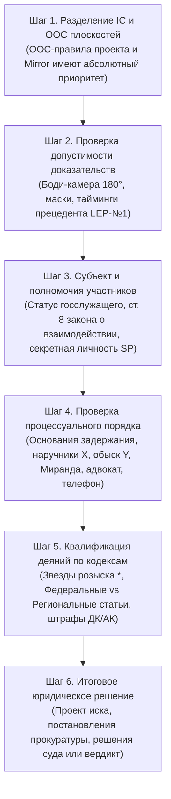

# Законодательная база и правовой анализ GTA 5 RP Mirror (`gta5rp-mirror-legislation`)

Этот скилл наделяет ИИ-агента полным экспертным знанием законодательства штата Сан-Андреас, судебных прецедентов ВС, OOC-правил и специфических игровых механик сервера **GTA 5 RP Mirror**.

---

## 0. Вызов и активация в чате / воркспейсе

Скилл и связанные с ним правила активируются при отправке любой из команд:
- **`/mirror-law <вопрос / описание ситуации / статья>`** — основной шорткод быстрого юридического разбора;
- **`/mirror`** — краткий вызов контекста законодательства сервера Mirror;
- **`/gta-law`** — общий правовой анализ ситуации в GTA 5 RP с адаптацией под законы Mirror;
- При упоминании в запросе: *«законы Mirror», «сервер Миррор», «статьи УК Mirror», «прецедент ВС», «задержание на Мирроре», «иск в суд Mirror»*.

> [!TIP]
> **Примеры пользовательских запросов**:
> - `/mirror-law Проверь законность задержания сотрудника LSPD агентом FIB за превышение полномочий.`
> - `/mirror-law Найди статью 17.6 УК и разъясни требования прецедента LEP-1.`
> - `/mirror-law Помоги составить исковое заявление в Верховный суд на заместителя Шефа LSPD.`
> - `/mirror-law Как квалифицировать отказ от оплаты штрафа, если гражданин нажал отмену?`

---

## 1. Быстрый поиск по законодательной базе (CLI-утилита)

В распоряжении агента находится локальный индекс **1241 статьи** всех 34 законов сервера Mirror, реестра судебных прецедентов и OOC-правил:

```powershell
# 1. Точный поиск конкретной статьи (мгновенно выдает санкции, розыск в звездах, примечания):
python "C:\Projects\gta5rp skills\gta5rp-mirror-legislation\scripts\search_mirror_law.py" --law УК --article 17.6
python "C:\Projects\gta5rp skills\gta5rp-mirror-legislation\scripts\search_mirror_law.py" --law ПК --article 15.1
python "C:\Projects\gta5rp skills\gta5rp-mirror-legislation\scripts\search_mirror_law.py" --law "взаимодействие" --article 8.1
python "C:\Projects\gta5rp skills\gta5rp-mirror-legislation\scripts\search_mirror_law.py" --law "ордера" --article 2.1

# 2. Полнотекстовый поиск по ключевым словам среди всех НПА:
python "C:\Projects\gta5rp skills\gta5rp-mirror-legislation\scripts\search_mirror_law.py" --query "неприкосновенность"
python "C:\Projects\gta5rp skills\gta5rp-mirror-legislation\scripts\search_mirror_law.py" --query "виртуальная парковка" --ooc

# 3. Поиск по судебным прецедентам ВС Mirror:
python "C:\Projects\gta5rp skills\gta5rp-mirror-legislation\scripts\search_mirror_law.py" --precedents --query "LEP-1"

# 4. Список всех 34 законов, слагов, алиасов и дат редакций:
python "C:\Projects\gta5rp skills\gta5rp-mirror-legislation\scripts\search_mirror_law.py" --list
```

---

## 2. Шестишаговый протокол правового анализа ситуации на Mirror

При разборе любого инцидента, видео-отката, иска или жалобы агент **обязан последовательно выполнить 6 шагов**:



### Шаг 1. Разделение IC и OOC плоскостей
- Сверься со справочником **[`references/mirror-ooc-overrides-and-precedents.md`](./references/mirror-ooc-overrides-and-precedents.md)**.
- Если в ситуации есть нарушение OOC-правил сервера (уход в ЗЗ, PG, DM, нонРП поведение, офф от ареста в наручниках `X`) — это наказывается администрацией (Деморган / Warn / Ban).
- Если IC-требование противоречит OOC-правилу сервера Mirror (например, штраф на виртуальной парковке по п. 3.17 или взятка на карту по п. 3.21) — действие признается **незаконным и ничтожным в силу OOC-запрета**.

### Шаг 2. Проверка допустимости доказательств и игровых условностей
- Сверься со справочником **[`references/mirror-game-mechanics-and-conventions.md`](./references/mirror-game-mechanics-and-conventions.md)**.
- **Боди-камера**: была ли функционально включена через инвентарь (доступна в `24/7`, сектор 180° от груди = IC запись).
- **Маска**: скрыта ли личность подозреваемого? (Помнить исключения: медицинские маски, байкерские шлемы и маски «вайфу» **не скрывают личность**).
- **Прецедент LEP-№1 ВС Mirror**:
  - Были ли указаны тайм-коды (п. 7 ст. 15.11 СК)?
  - При обвинении по **ст. 17.6 УК** (Неповиновение): зафиксированы ли **оба требования** и выжданы ли **10 секунд**?
  - При обвинении по **ст. 17.7 п. 3 УК** (Отказ от штрафа): выписан ли тикет и прошло ли **20 секунд**?

### Шаг 3. Субъект и специальные полномочия отделов
- Сверься со справочником **[`references/mirror-codes-and-qualifications.md`](./references/mirror-codes-and-qualifications.md)**.
- **Если задержанный — государственный служащий при исполнении**:
  - Задержание на месте разрешено **СТРОГО** по основаниям **ст. 8.1 / 8.2 Закона о взаимодействии силовых структур** (`#3423973`) (нападение, угон, сбыт оружия, тяжкие преступления глав 6–10, 12.8, ЗОТ 12.7).
  - За должностные статьи (15.1, 15.6) задерживать госника на месте **ЗАПРЕЩЕНО** — только видеофиксация и направление дела в Прокуратуру!
- **Секретная личность (`SP`)**:
  - Если сотрудник носит жетон со статусом `SP`, он не показывает удостоверение и не открывает лицо; его идентификатор — номер жетона.
- **Эксклюзивные полномочия отделов на Mirror**:
  - Написание кейс-файлов на рейды — **только отделы `DB` (LSPD/LSSD) и `CID` (FIB)**!
  - Патруль штата на поиск дезертиров армии — **только военная полиция `MP` National Guard**!

### Шаг 4. Процессуальный порядок задержания и обыска
- **Обыск**:
  - Без наручников гражданин должен подтвердить обыск через клавишу **`Y`**;
  - В наручниках — согласия не требуется, госник видит все предметы;
  - `SPUNK` с эффектом и косяки = наркотики (доказывать не нужно); нелегальное оружие = достаточно снимка меню обыска;
  - Досмотр багажника ТС — изъятие **только при содействии администрации через репорт** (п. 3.16 доп. правил Гос).
- **Реализация прав**:
  - Предоставлен ли телефонный звонок (освобождается одна рука через меню)?
  - Вызван ли адвокат через рацию департамента (или текстовую рацию, п. 3.19)?
  - Вызваны ли прокурор и начальство при задержании госника?
- **Посадка в КПЗ vs ФТ**:
  - КПЗ — 1–30 минут, выход под залог через адвоката;
  - ФТ (SASPA) — 1–30 минут (СИЗО от LSPD/LSSD/SASPA), до 60 минут (FIB). Досрочный выход — только УДО от судьи или помилование от Губернатора.

### Шаг 5. Квалификация по статьям кодексов Mirror
- Извлеки точную формулировку статьи через `search_mirror_law.py --law <кодекс> --article <номер>`.
- Проверь приоритет розыска по количеству звездочек `*` в статье УК (1–5 звезд).
- Помни: 4 звезды — только тяжкие статьи в рамках ОРМ; 5 звезд — только по ордерам.
- При наличии 3 и более региональных статей подозреваемый подлежит отправке в Федеральную Тюрьму Болингброук (ст. 4.6 УК СА).

### Шаг 6. Итоговый процессуальный документ
- Сформируй официальный акт в зависимости от роли заявителя:
  - **Исковое заявление в Суд** (с проверкой подсудности: Окружной/Федеральный суд `FJ` для рядовых лиц, Верховный суд `SJ` для неприкосновенных и руководства фракций);
  - **Постановление или требование Прокуратуры**;
  - **Судебное определение или решение**;
  - **Адвокатское ходатайство или жалоба**.

---

## 3. Справочники модуля

Все детализированные материалы находятся в папке `references/`:
1. **[`mirror-legal-hierarchy-and-gov.md`](./references/mirror-legal-hierarchy-and-gov.md)** — пирамида юридической силы, ветви власти, структура ОГП, судов и полный каталог 34 тем НПА раздела 2181.
2. **[`mirror-codes-and-qualifications.md`](./references/mirror-codes-and-qualifications.md)** — статьи УК, ПК, СК СА, ст. 8 задержания госслужащих, 10 видов ордеров Mirror, полномочия DB/CID и MP.
3. **[`mirror-game-mechanics-and-conventions.md`](./references/mirror-game-mechanics-and-conventions.md)** — клавиши X/Z/Y, плашка WANTED в ЗЗ, статус SP, боди-камеры 24/7 180°, КПЗ vs ФТ, отыгровки /try на угонках, поставки и штурмы.
4. **[`references/mirror-ooc-overrides-and-precedents.md`](./references/mirror-ooc-overrides-and-precedents.md)** — прецедент ВС LEP-№1 (10с на ст. 17.6, 20с на ст. 17.7), переопределения правил Гос (3423926), Общих правил (3423927) и регламент штурма титульного района.
5. **[`references/laws/`](./references/laws/)** — полные тексты всех 34 законов, кодексов и файл поискового индекса `laws_index.json`.
