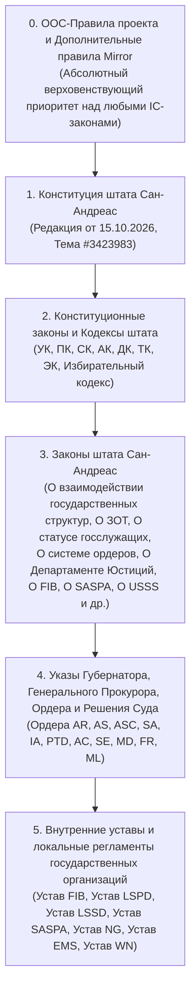

# Иерархия нормативно-правовых актов и устройство власти штата Сан-Андреас (Сервер Mirror)

В данном справочнике систематизирована полная архитектура государственной власти и законодательная база сервера **GTA 5 RP Mirror** (раздел 2181 форума).

---

## 1. Пирамида юридической силы НПА на сервере Mirror

При правовом анализе любой ситуации или разрешения правовых коллизий ИИ-агент должен строго руководствоваться иерархией юридической силы:

> [!IMPORTANT]
> **Принцип разрешения коллизий**:
> 1. Если пункт внутреннего Устава организации противоречит Трудовому, Процессуальному или Уголовному кодексу — уставный пункт **ничтожен**, применяется норма Кодекса.
> 2. Если закон или указ противоречит Конституции штата Сан-Андреас — применяется Конституция.
> 3. Если любое IC-положение противоречит **OOC-правилам сервера Mirror** (раздел 2164) или Общим правилам проекта (раздел 5) — безоговорочный приоритет имеют **OOC-правила**.

---

## 2. Устройство ветвей власти и государственных структур на Mirror

### 2.1. Законодательная власть
- **Законодательный Совет штата Сан-Андреас** (Конституция, Раздел 4, ст. 1–2; Положение о законодательной инициативе `#3424765`):
  - Высший представительный и законодательный орган штата.
  - Принимает поправки в Конституцию, утверждает кодексы и законы.
  - Граждане имеют право вносить законодательные инициативы через портал штата.

### 2.2. Исполнительная власть
- **Офис Губернатора** (Закон о Правительстве `#3423970`):
  - **Губернатор штата** — высшее должностное лицо исполнительной власти, верховный главнокомандующий Национальной Гвардии. Обладает исключительным правом помилования заключенных ФТ.
  - **Вице-Губернатор** — замещает Губернатора, координирует работу Кабинета Министров.
- **Департамент Юстиций (DOJ)** (Закон о Департаменте Юстиций `#3423969`):
  - Возглавляется **Офисом Генерального Прокурора (ОГП)** (Генеральный Прокурор и Заместители ГП).
  - В состав Департамента Юстиции входят:
    1. **Прокуратура штата** — надзор за законностью, ведение досудебного следствия, надзор за силовыми структурами, плановые/внеплановые проверки (`#3423961`), выдача ордеров, государственное обвинение в суде.
    2. **Federal Investigation Bureau (FIB)** (`#3423972`) — федеральное правоохранительное агентство по борьбе с терроризмом, организованной преступностью и коррупцией.
    3. **San Andreas State Prison Authority (SASPA)** (`#3424269`, `#3423964`) — администрация Федеральной тюрьмы Болингброук и обеспечение пенитенциарного надзора.
- **Министерство Внутренней Безопасности (МВБ)** (ст. 17 разд. 5 Конституции):
  - Возглавляется Министром Внутренней Безопасности; формирует Совет Национальной Безопасности (ст. 22 разд. 5 Конституции).
  - Включает **Службу Безопасности Штата (USSS)** (`#3423962`) — охрана первых лиц и правительственных объектов, борьба с фальшивомонетничеством, антикоррупционные проверки.
- **Министерство Экономики и Финансов (МЭиФ)** (ст. 17.1 разд. 5 Конституции):
  - Включает **Экономическое Управление (ЭУ)** — финансовый и лицензионный надзор бизнеса (`#3423977`) — и **Управление труда**.
- **Министерство Социального Развития (МСР)** (бывш. Министерство Социальной Защиты):
  - Курирует **Emergency Medical Service (EMS)** (`#3423976`) и проведение медицинских проверок (`#3423978`).
  - Курирует средства массовой информации (**Weazel News**) (`#3423958`).
- **Служба федеральных маршалов (USMS)** — входит в судебную ветвь власти, обеспечивает деятельность судов (ст. 15 разд. 6 Конституции, гл. 10 Судебного кодекса); заменила судебных приставов.
- **Коллегия Адвокатов** (Закон об адвокатуре `#3423966`) — независимый орган; глава и сотрудники назначаются приказом Губернатора (ст. 18 разд. 5 Конституции):
  - Государственные и частные адвокаты; юридическая защита граждан при задержании, процессуальных действиях и в суде; процедура выхода под залог из КПЗ.

### 2.3. Судебная власть (Судебный кодекс `#3424313`)
- **Окружной суд (District Court, `DJ`)** (гл. 5–6 СК; Федеральный суд `FJ` упразднён, индекс встречается в архивных делах):
  - Суд общей подсудности (ст. 5.2): **все гражданские и трудовые споры** (моральный вред, дисциплинарные взыскания) **независимо от должности и неприкосновенности ответчика**; уголовные и административные дела, не отнесённые к Верховному суду.
  - Состав: окружные судьи и Председатель Окружного суда.
- **Верховный суд (Supreme Court, `SJ`)** (гл. 7–8 СК):
  - **Специальная подсудность** (ст. 7.2): уголовные и административные дела против Губернатора, Вице-Губернатора, сотрудника Офиса Генпрокурора, судьи, министра, Директора USMS и его заместителя, кандидата в Губернаторы, руководителя или заместителя руководителя госструктуры, руководителя неофициальной/частной/коммерческой организации; иски к штату (кроме гражданских и трудовых споров); конституционные дела (гл. 31).
  - Ошибка подсудности — передача дела определением (ст. 5.6, 7.5), а не отказ.
  - Состав: верховные судьи и Председатель Верховного суда; Пленум ВС (ст. 7.6).
- **Апелляционное производство** (гл. 33 СК):
  - Жалобы на итоговые акты Окружного суда подаются в Верховный суд в течение **24 часов** (ст. 33.3, 33.6); рассматривают верховные судьи (ст. 33.2).
- **Кассационное производство** (гл. 34 СК):
  - Пересмотр вступивших в силу актов; жалоба — в течение **24 часов** (ст. 34.5); рассматривает **Председатель Верховного суда** (ст. 34.2), постановление не обжалуется (ст. 34.3).

### 2.4. Силовые ведомства и их региональные зоны
- **Региональные правоохранительные органы (Закон `#3423974`)**:
  - **LSPD (Los Santos Police Department)** — юрисдикция город Лос-Сантос.
  - **LSSD (Los Santos Sheriff's Department)** — юрисдикция округ Блэйн и округ Лос-Сантос (за пределами черты города).
- **Федеральные силовые структуры**:
  - **FIB** — федеральная юрисдикция по всей территории штата Сан-Андреас.
  - **National Guard (SANG)** (`#3423975`) — Форт-Занкудо, охрана военных поставок, патруль военной полицией (MP), режим ЧП/ВП.

---

## 3. Реестр всех 34 тем Законодательной базы Mirror (Раздел 2181)

| № | Слаг в скилле | Название темы на форуме | ID темы | Редакция |
|---|---|---|---|---|
| 1 | `constitution` | Конституция Штата | `3423983` | 08.11.2026 |
| 2 | `criminal_code` | Уголовный Кодекс | `3424268` | 11.11.2026 |
| 3 | `procedure_code` | Процессуальный Кодекс | `3424266` | 11.11.2026 |
| 4 | `court_code` | Судебный кодекс | `3424313` | 08.11.2026 |
| 5 | `administrative_code` | Административный Кодекс | `3424267` | 11.11.2026 |
| 6 | `traffic_code` | Дорожный Кодекс | `3423980` | 01.10.2026 |
| 7 | `labor_code` | Трудовой Кодекс | `3423982` | 08.11.2026 |
| 8 | `ethics_code` | Этический Кодекс | `3423981` | 01.10.2026 |
| 9 | `warrant_system` | Закон о системе ордеров | `3423979` | 08.11.2026 |
| 10 | `closed_and_protected_areas` | Закон о закрытых и охраняемых территориях (ЗОТ) | `3423971` | 02.11.2026 |
| 11 | `fib` | Закон о Federal Investigation Bureau | `3423972` | 02.11.2026 |
| 12 | `secret_service_usss` | Закон о United States Secret Service | `3423962` | 02.11.2026 |
| 13 | `state_officials_status` | Закон о правовом статусе государственных служащих | `3423960` | 11.11.2026 |
| 14 | `law_enforcement_interaction` | Закон о взаимодействии государственных структур | `3423973` | 02.11.2026 |
| 15 | `state_secrets` | Закон о государственной и служебной тайне | `3423959` | 08.11.2026 |
| 16 | `weapons` | Закон об оружии | `3423967` | 06.10.2026 |
| 17 | `saspa` | Закон о San Andreas State Prison Authority | `3424269` | 08.11.2026 |
| 18 | `penitentiary_institutions` | Закон о пенитенциарных учреждениях | `3423964` | 06.10.2026 |
| 19 | `justice_department_and_prosecution` | Закон о Департаменте Юстиций | `3423969` | 08.11.2026 |
| 20 | `regional_law_enforcement_lspd_lssd` | Закон о региональных правоохранительных органах | `3423974` | 06.09.2026 |
| 21 | `national_guard` | Закон о National Guard | `3423975` | 02.11.2026 |
| 22 | `ems` | Закон о Emergency Medical Service | `3423976` | 02.11.2026 |
| 23 | `bar_association` | Закон об адвокатуре и адвокатской деятельности | `3423966` | 02.11.2026 |
| 24 | `government` | Закон о Правительстве | `3423970` | 30.10.2026 |
| 25 | `document_flow` | Закон о документообороте | `3425164` | 26.10.2026 |
| 26 | `legislative_initiative` | Положение о законодательной инициативе | `3424765` | 07.10.2026 |
| 27 | `medical_inspections` | Положение о медицинских проверках государственных организаций | `3423978` | 02.11.2026 |
| 28 | `prosecution_inspections` | Положение о прокурорских проверках государственных организаций | `3423961` | 01.10.2026 |
| 29 | `special_regimes` | Закон об особых режимах и положениях (ЧП, ВП, ТК) | `3423968` | 02.11.2026 |
| 30 | `entrepreneurship` | Закон о предпринимательской деятельности | `3423977` | 02.11.2026 |
| 31 | `electoral_code` | Избирательный Кодекс | `3423965` | 01.10.2026 |
| 32 | `media_weazel_news` | Закон о средствах массовой информации | `3423958` | 06.10.2026 |
| 33 | `biological_resources` | Закон о добыче и сохранении биологических и охотничьих ресурсов | `3423963` | 11.11.2026 |
| 34 | `law_changes_info` | Информация об изменениях в законодательной базе | `3424474` | Актуальная |

Полные тексты всех законов хранятся в `references/laws/<слаг>.md`.
Для точного извлечения статьи используйте утилиту:
`python search_mirror_law.py --law <слаг/алиас> --article <номер>`
